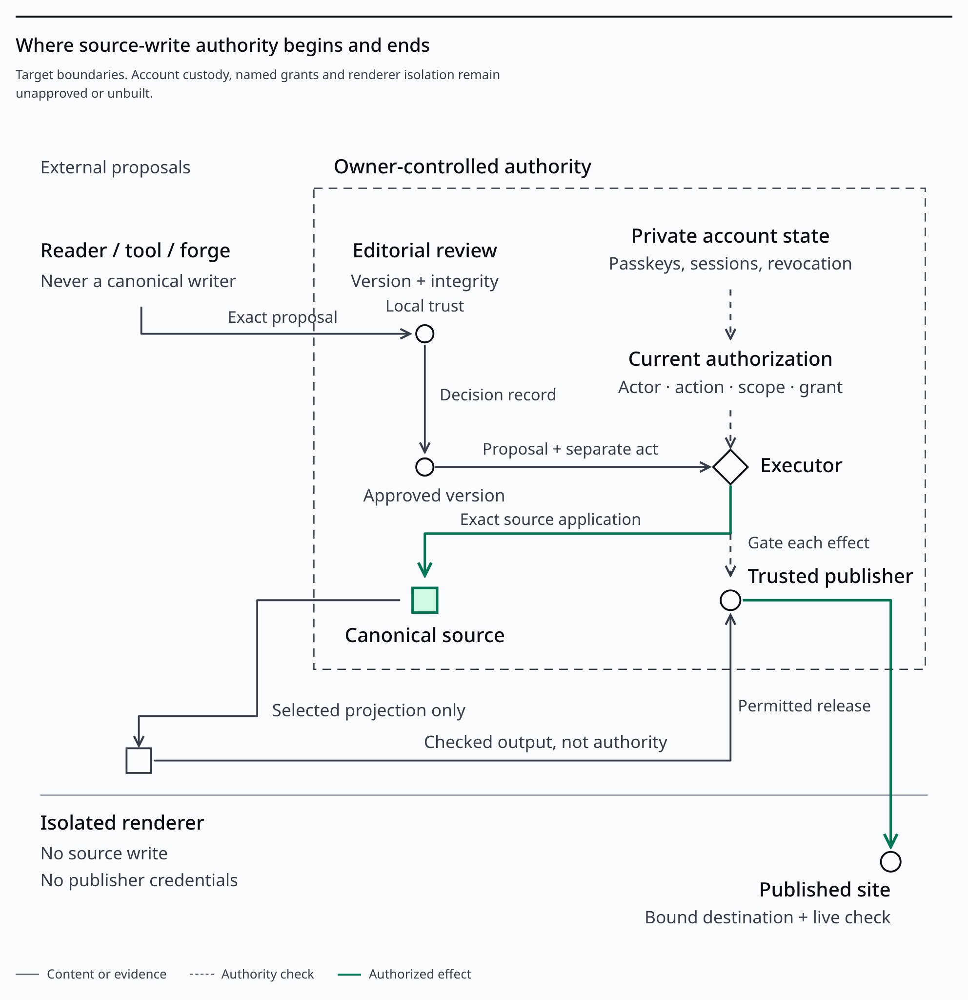
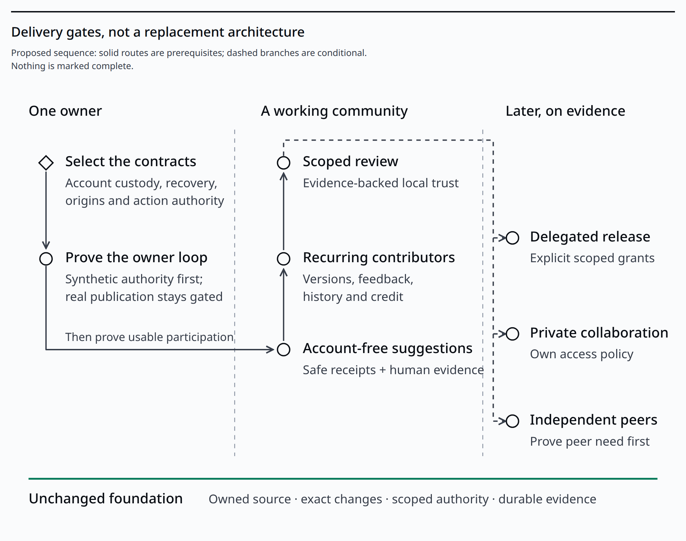

import CommunityDiagram from '../../../components/CommunityDiagram.astro';

## What this design is for

Build **one owner-governed contribution system that can grow into shared stewardship**, not an owner tool followed by an unrelated community product. The [community model](/cyberbaser/design/contribution-trust-and-access/) explains the people and journeys. This page translates that model into responsibilities, records, transitions and implementation gates.

**Status, 2026-11-13:** first integrated design proposal, not a selected wire schema, security certification or implementation authorization. The maintainer asked to continue designing from the stored knowledge. Two bounded evidence reviews and coordinator source checks ground this proposal. Existing exact-change, immutable-decision and separate owner-application mechanisms remain authoritative. New custody, grant, recovery and editorial contracts below are recommendations requiring explicit selection before implementation. This worktree predates a newer unapplied candidate elsewhere; this design does not claim that candidate or the deployed system was inspected.

<CommunityDiagram kind="authority" />

## The architectural decision

Keep three kinds of state separate:

1. **Identity and access state:** accounts, authenticators, sessions, current grants and revocations. Private and mutable, with its own lifecycle.
2. **Editorial and governance evidence:** exact proposal versions, decisions, observed outcomes, trust designations and attribution choices. Historical records must remain interpretable without treating old permission as a current grant.
3. **Canonical content and publication policy:** the owner's version-controlled source and the policy governing its permitted changes and disclosure. Editors, discussion threads, queues and profiles are not another content authority.

A current authorization decision permits an effect; a historical receipt proves what was decided or observed. Neither a login nor an old receipt can substitute for the other.

Logical boundaries do not require separate microservices. The unauthenticated intake must remain outside owner authority, and rendering must not inherit writer credentials. The exact host/container arrangement remains conditional on the [container design and platform evidence](/cyberbaser/research/truenas-container-viability/).

## System responsibilities

| Responsibility | Owns | Must not become |
|---|---|---|
| Account adapter | Passkey/account verification, sessions, recovery and revocation | A source writer or editorial trust engine |
| Intake adapters | Bounded submission, carrier provenance and separately verified identity evidence | An approver, privileged-session holder or source writer |
| Editorial workspace | Proposal versions, feedback, decision presentation and outcome views | A second canonical document store |
| Trust evaluator | Local evidence-backed designations and explainable review requirements | A universal reputation score or publisher credential |
| Action authorizer | Current subject/action/content/destination/condition decisions | A whole-file writer or an inference from UI visibility |
| Owner executor | Exact source application and explicitly authorized publication through durable jobs | A generic command runner controlled by contributors |
| Governance history | Source-qualified facts, actor provenance, grants/decisions/outcomes and consented credit | A credential store, unfiltered public log or mutable rewrite of past decisions |

These are target responsibilities. Current packages only cover parts of them. Reuse the existing executor and immutable evidence rather than creating a second writer.

## 1. Identity without an account wall

### Recommended identity vocabulary

Represent **verified local principal**, **verified external subject**, **unverified claim**, and **anonymous submission** distinctly. A local account is not required merely because an external subject is known, and anonymous submissions do not all belong to one pseudo-user with accumulating reputation.

For local accounts, use an opaque stable identifier. External subjects remain qualified by their verifier/issuer and stable subject identifier; a display name or email match is not account linking. Linking identities needs a separate proof-of-control process and a retained linkage event. Do not retroactively assign anonymous work to someone because they know its public text or present its receipt.

The existing trust package lowercases its string IDs. That is a compatibility detail, not a safe universal rule for new issuer/subject identifiers. A future adapter must map subjects deliberately and collision-safely without rewriting existing classification evidence.

### Passkeys and recovery

Embedded Better Auth with passkeys is the preferred direction, not shared SSO. For later contributor accounts, passwords are an owner setting, off by default, with breached-password refusal through Better Auth's Have I Been Pwned plugin; see [access tiers](/cyberbaser/design/contribution-trust-and-access/#access-tiers-abuse-protection-without-a-forced-account). Accounts provide continuity and higher limits, not the primary bot defense. Cyberbaser should not implement its own credential cryptography. Before enrollment, define the stable relying-party domain, secure origin, session lifecycle, owner bootstrap, recovery and authenticator removal rules. A numeric private deployment address is not automatically the final browser identity origin. Avoid enrolling real passkeys before that origin contract is settled.

Recommended first account policy: one explicitly enrolled owner; no open local registration until contributor account admission and abuse/recovery rules are designed. Anonymous suggestions remain independent. A public contributor identity should not be created simply to let a correction reach review.

Credential custody is an explicit architecture decision before implementation: current restrictions do not select persistent local accounts or sessions. The proposed small account adapter must own that custody without placing credentials in proposal packages, Git policy, decision receipts, renderer mounts or public history. This page does not silently amend the existing restriction.

### Proposed narrow custody amendment

**Recommendation for owner approval:** allow an owner-operated, replaceable account component to be authoritative for its own local accounts, passkey public-credential bindings, revocation state and session verifiers. The prohibition on identity/session custody continues to apply to pure proposal/trust packages, rendering, public intake and governance artifacts. It remains prohibited to establish a global Cyberbaser identity service or to import another application's account database by convenience.

A local account registry is a real identity authority for its own accounts, even when implemented by a replaceable library. Name that exception honestly. Specify supported storage, private permissions, encrypted backups, restoration and deletion before shipping it. Passkey private keys stay with authenticators; server-held account bindings and session/recovery authority still need protection. Never restore formerly valid sessions or obsolete grants merely because an old backup contains them. Recovery must invalidate or explicitly reconcile security epochs before the service can authorize new effects.

The first release should enroll one owner through a local, single-use setup action that stops working after enrollment. Recommend multiple passkeys before ordinary use. There must be a separately designed owner-controlled recovery path; losing an authenticator must not force permanent lockout, but ordinary public email reset or the old unrestricted bootstrap cannot quietly become a weaker alternate publisher login. Account enrollment, authenticator addition/removal and recovery all need audit and appropriate recent authentication. Exact recovery ceremony and authentication timeouts are implementation-gate decisions, not improvised defaults.

### Session and browser-origin contract

Recommended sessions resolve to a stable principal, authentication time, explicit lifetime and revocation state. Browser credentials remain opaque, host-only and protected by Secure/HttpOnly cookie attributes; do not put roles or bearer secrets in URLs or public client storage. Check exact mutation origin and CSRF independently of SameSite. Session rotation, logout and per-device revocation must work without restarting the entire service. Durable jobs must not contain reusable session tokens.

Choose one stable privileged HTTPS hostname and a narrow relying-party ID before real passkey enrollment. Keep ordinary reader and privileged application hosts separate; ports alone do not isolate cookies. Preserve the stricter separate-registrable-domain requirement for the separately gated untrusted private-preview path. A private overlay carrying HTTP does not itself make an arbitrary private-IP origin suitable for remote WebAuthn.

The internal service may retain an exact private numeric bind behind a deliberately configured HTTPS ingress. That needs a new explicit internal-bind/external-origin contract, not arbitrary trust in forwarded headers or rewriting incoming Origins. Restrict direct-backend access, pin the external origin, validate only known forwarding paths, and derive owner links from the verified configuration. Domain or port changes require explicit origin checks; an RP-domain change needs a re-enrollment/migration plan. None of this selects a real domain or authorizes public exposure.

## 2. Explicit responsibility, not implicit promotion

### Conceptual grant

A proposed grant names:

- the authenticated subject;
- one or more explicit actions, such as review, Apply or Publish;
- repository/content scope using authoritative identifiers, not contributor labels;
- the publication destination when applicable;
- conditions, validity interval and revocation identity; and
- who issued it under which policy.

This is a conceptual contract, not chosen JSON or role names. Treat collections as owner-controlled policy scopes, not whatever folder/tag a proposal claims to belong to. Moving content or changing a collection policy must not silently enlarge an existing grant.

Account administration and permission-grant administration are distinct. Someone who can reset an account must not acquire the power to make it a publisher. Initial owner-only configuration may assign both deliberately; the implementation must preserve their distinction.

### Decision rules

Authorize server-side against current verified identity, current grant/policy and exact target evidence. UI controls are projections, not enforcement. Reject unavailable or ambiguous scope rather than choosing a permissive interpretation. Preserve exact account IDs rather than using a mutable display label as authority.

A review grant does not imply Apply or Publish. The current Apply-to-page starts a pipeline that includes publication; until a separately designed apply-only route exists, a future delegate would need authority for every combined effect. Do not offer an Apply permission that silently publishes beyond its scope.

Recommended first configuration: only the owner can decide, apply, publish or manage grants. Scoped delegates are a later configuration requiring negative-path and revocation evidence. Self-review, multiple-reviewer thresholds and conflicting decisions must be selected before enabling delegated review, not inferred from trust level.

### One action boundary across every entry point

Use one internal action-authority contract for HTTP handlers, trusted programmatic callers and recovery admission. Conceptually it receives a verified principal reference, requested action, authoritative content identity/scope, exact candidate/evidence reference and destination; it evaluates current grants and policy and returns a bounded permit or a reasoned refusal. It does not accept a principal, role or permit merely because a browser supplied that field. A permit is an internal result, not a bearer token handed to an editor.

| Entry point | Required target checks | Existing behavior to preserve |
|---|---|---|
| List/read proposal evidence | Evidence-read scope before enumeration, counts and object response | Owner-only evidence is private; omitted documents alone do not make JSON public-safe |
| Prepare/review a publication draft | Source-read and preparation scope for the selected content | Preparation is not an executable publication job |
| Approve/Reject | Evidence-read plus review scope for the exact revision | Independent evidence reload; immutable decision-only receipt |
| Apply to page | Exact approval, application scope and every publication effect performed by the current combined job | Separate deliberate act; no automatic effect from approval |
| Save-and-publish | Source-edit/application and publication scope | Same exact-change constraints; no alternate lower-privilege writer |
| Publish | Exact captured version, source/policy binding and destination scope | One bound durable job and replay-safe outcome |
| Inspect a job or decision | Independent result/evidence-read scope | No cross-user job enumeration or private-reason leak |
| Restart/recovery | Trusted service caller, exact retained job and phase-appropriate continuation authority | No browser cookie dependency; no replay of ambiguous effects |

The current session gate does not implement these grants. Current Publish storage explicitly relies on its caller for authentication; moving a check into only that store or one button would leave other paths inconsistent. The actor recorded in future decisions/jobs must be the verified principal, distinct from configured forge owner and machine credential identity. Existing records retain their historical configured-owner provenance; do not backfill it as verified authentication.

## 3. Contributions are threads of immutable versions

### Preserve the existing v1 payload

Current canonical proposal bytes and their digests remain unchanged. Do not add a contributor profile, comment thread, mutable title or revision counter inside a retained v1 artifact. A future editorial record can reference an exact versioned proposal artifact and carry its own versioned metadata.

Recommended future separation:

| Record | Meaning |
|---|---|
| Contribution | The continuing editorial intent and its provenance; not a source file |
| Proposal revision | An immutable exact candidate against an identified source base, linked to its predecessor |
| Feedback item | Discussion or request for changes, with actor and visibility; no application authority |
| Review decision | A decision about one exact revision/evidence digest, not whatever revision is latest |
| Application event | A separately authorized attempt bound to the exact approved evidence and durable job |
| Publication observation | What a particular job/destination actually did, separately from intent |

These records do not yet exist as a selected general schema. The existing Forgejo watcher provides a narrow precedent: the same head deduplicates, a new head creates separate evidence, and the UI folds older heads. That is not already a complete revision protocol.

### Transitions and conflict handling

A contributor submits revision A. Feedback can request a correction without changing A or its review record. Revision B links to A and requires its own decision. Approval of A never floats forward to B. Concurrent revisions must be shown as distinct alternatives until an authorized resolution; do not silently choose the last arrival or rebase source.

Existing owner decisions are create-once Approve or Reject records. Preserve their retry and contradiction behavior. A later reconsideration would require a new, explicitly related record and selected authority rules, not editing the original decision. Request-changes is future feedback, not a third action inserted into the current decision schema.

An owner may record approval of historical evidence even when source has moved on. Apply independently assesses current eligibility. The existing rule permits unrelated branch advancement when the exact source blob/mode and required policy still match; it does not require inventing a new proposal for every repository commit. Changed source or policy must not be treated as an automatic rebase opportunity.

## 4. Trust grows from evidence, not queue volume

### First implementation: explicit local designation

Keep the existing classifier and manual owner designation as the starting point. Preserve its routes, reasons and mechanical checks. Do not reinterpret its `auto-merge` route as authorization to execute anything, and do not reuse current size caps as community promotion thresholds.

The concrete Cyberbase policy currently describes roughly three unproblematic merged edits and no appeals process at its scale. Those are dogfood policy choices, not a general product algorithm. The community model's evidence-backed progression and future reconsideration recommendations do not silently change that policy.

### Future contribution history

The finite queue cannot be the history store: it expires and purges submissions, and its source partition is a repository/path partition, not a person. Existing decision receipts survive queue expiry, but are not yet a complete community history. The PR ledger observes particular closure facts and cannot be relabelled a universal contributor record.

Recommended history design: retain source-qualified contribution/outcome facts separately from temporary intake; build rebuildable, privacy-filtered views over those facts. Separate private operational evidence from any owner-approved portable or public projection. Existing commit-backed governance rules remain; do not introduce a new authoritative history database by calling a cache a ledger. Exact storage and retention policy must be selected before implementation.

Before computing trust, define what counts as one contribution. Repeated delivery, successive PR heads, revisions and reopened/closed observations cannot each count as another accepted improvement. A contribution can have several contributors; do not invent a single-owner attribution rule without a decision. Imported facts must retain origin and observation time, including whether evidence was available at decision time or learned later.

Recommended progression starts as an explainable owner suggestion, not automatic promotion: show qualifying evidence, current scope and the proposed policy change. Rejection alone is not misconduct. Reversal, dispute or missing evidence must not silently erase history or retain an unjustified privilege.

## 5. Governance and credit without unintended disclosure

Keep contributor, reviewer, acting publisher and machine executor distinct. The current proposal Apply pipeline makes an owner-authored commit; it does not already preserve the contributor as commit author. Do not add credit trailers without changing and verifying the recovery contract that reconstructs commit messages.

Recommended public credit is an explicit projection: approved identity/display attribution and contribution references only, under consent and content-license policy. Private rationale, moderation notes, identity proofs, network identifiers, job diagnostics and account recovery material stay private. Removing optional public profile data must not falsify historical decisions; retention, legal attribution and deletion requirements need a selected policy.

Anonymous outcome access remains a separate design problem. A future unguessable receipt capability could permit a narrow view, but its disclosure, expiry, loss and reply semantics require threat analysis. It must not establish verified identity, allow account claiming or reveal private evidence. The current queue ID alone is not a safe public authorization token.

## 6. Durable authority, revocation and recovery

### Recommended contract: accepted intent, gated effects

An authenticated action can accept one durable job without keeping the browser session alive. Closing the browser, logging out or ordinary session expiry prevents further interactive use; it does not by itself cancel that accepted job. Account disabling, grant revocation and an explicit stop request are different events and must be visible as such.

Do not make durable acceptance an irrevocable license to perform every later effect. Recommend rechecking current authority at effect boundaries, especially before source application and before the outward push/deploy trigger. The accepted intent binds principal, actions, exact base/candidate, source policy, permitted destination and job identity. No browser credential is retained. Current grant/subject epochs are checked independently from the immutable content policy and candidate.

**Race rule to design and prove:** grant revocation and effect-start admission must have one serialized ordering in the trusted authority boundary. A durable effect-start admission won before revocation may permit only that bounded, already-starting step to finish or be reconciled. If revocation wins first, that step cannot start. There is no promise to interrupt an external request already in flight. A timestamp comparison after the fact, or a non-atomic check followed by an unguarded effect, is insufficient. Admission must have bounded validity and cannot become a reusable offline capability.

Use existing job identity and locking/recovery mechanics where they fit, but do not claim their current source locks already serialize account/grant revocation. Exact storage/transaction and effect-admission semantics must be frozen and adversarially tested before implementation acceptance.

### Recommended phase behavior

| Observed phase | After permission revocation or unavailable authorization | What remains allowed |
|---|---|---|
| Draft, no accepted authority | Deny a new authorization | Retain only according to draft/access policy |
| Authorization record, no accepted job | Recheck before acceptance; no stale replay into a new effect | Inspect/reconcile existing traces without inventing a second job |
| Accepted, before first source effect | Hold/refuse new effect admission | Bounded cancellation/cleanup and authorized status access |
| Source effect admitted/in flight | Do not claim it was prevented; finish only the admitted step or reconcile | Record exact facts; no automatic second attempt |
| Ambiguous application after crash | Preserve current refusal of automatic replay | Owner/operator investigation; no guessed rollback |
| Source changed or committed, not pushed | Stop before any newly unauthorized mutation or outward effect | Preserve changed bytes and evidence; deliberate owner resolution, no automatic revert or push |
| Push/deployment trigger admitted/in flight | Revocation cannot retract that request | Reconcile the exact remote outcome; do not issue a new unapproved request |
| Already pushed/published | Do not claim content was recalled | Read-only observation of the bound job and private evidence completion |

This deliberately introduces a possible **changed locally, publication held** outcome. It is safer than silently publishing after revocation, but it can leave a checkout requiring owner attention. A coherent owner recovery screen and explicit resume authority are part of the feature, not cleanup deferred to operators. A later authorized resume must name the retained exact candidate and destination and use the same effect history; whether a new compatible attempt record is needed must be resolved against existing one-job semantics before implementation.

Read-only deployment observation may continue under a narrow service identity after browser logout or publisher revocation. Access to the resulting evidence remains separately authorized. If observation credentials are also revoked or unavailable, record observation as unavailable rather than manufacturing success. Do not introduce fresh authoring-host reads after source application just to recover a completed effect; current post-apply source-independence is intentional.

## 7. Private evidence and service isolation

Filter permission before returning list rows, counts, source paths, candidate text or job relationships. Perform the object-level check again on detail access. Review permission is useless without the appropriate evidence-read scope, but must not grant access to unrelated documents. Current owner APIs and HTML are not a public receipt API or a multi-user access model.

The public contribution boundary should see only retained published-source evidence and its permitted queue. The private authorizer/executor holds no publicly callable account-free write route. The renderer gets only selected projection/toolchain/scratch, never canonical write access, account/session storage, job authority or credential sockets. The credential broker accepts only trusted publisher access; its existing helper's repository check is not proof of per-job authority. Require an authenticated bounded broker contract before claiming it enforces branch/job/candidate scope.

Optional authoring-host read/export permission remains independent from Cyberbaser effect permission. Check host permission when capturing/retrieving content, and bind the exact captured version; do not import the host's cookies, account database or workspace role into Publish authority. A revoked host read prevents new reads but cannot erase copies already legitimately captured. The selected copy-retention and explicit publication policy determine what may happen next; possession of a copy alone never authorizes publication.

## 8. Delivery sequence and decision gates

<CommunityDiagram kind="horizons" />

### Gate A: select the first security contract

Recommend the narrow local-account custody amendment, one owner account with passkeys, no public local registration, separate secure owner/reader origins, explicit action grants and the phase-based revocation contract above. This is a small account-and-authority component, not a general identity provider or forum platform. Freeze the recovery ceremony, session timeouts, storage/restore behavior and effect-admission ordering before writing implementation. Selecting those contracts does not select a real domain, host deployment or source move.

**Deliverable:** an approved bounded contract and synthetic acceptance matrix, with current capability-mode compatibility and migration behavior explicit. Existing historical jobs/receipts must not silently become account-authorized; ambiguous migration stops for deliberate owner handling.

### Slice B: named owner authority, with no new public lane

Implement the approved account/session adapter, internal action authorizer and private evidence checks for one owner. Wire every existing effectful entry point, including startup recovery and trusted programmatic callers. Keep current proposal shapes, trust behavior and source-application semantics intact. Test nonpublisher, wrong origin, bootstrap bypass, account collision, session/grant revocation and interrupted-job cases with disposable fixtures.

**Exit:** owner actions record a verified actor and exact authority; a logged-in nonpublisher cannot find an alternate route to a publishing effect. Tests must exercise actual route and recovery composition, not only a pure permission helper. This slice does not authorize deployment or automatically resume old jobs.

### Slice C: one coherent real owner loop

Recover/integrate the preserved candidate rather than rebuilding it. Reconcile authoritative authoring source and delivery checkout, then bind one selected already-public page and permitted destination. For the split-source authoring-to-Publish route, later source edits stay unpublished until separately captured and reviewed. Keep direct delivery editing and external Apply disabled until their return-to-authoritative-source mechanism is selected and proven.

Renderer isolation, scoped credential custody, origin deployment and actual host compatibility are release gates for the planned always-on setup, not optional consequences of successful login. A VM is conditional, and TrueNAS-managed Apps remains the first platform candidate. Existing migration/live-execution holds require their own explicit clearance.

**Exit:** one separately authorized real owner publication with accurate actor, exact content, preserved unrelated edits, recoverable outcome and live verification. No community-usability or public intake claim follows.

### Slice D: useful public participation

Finish the account-free product path: safe intake exposure, abuse limits, exact published-source binding, understandable review/outcome and deliberate attribution. Choose the reduced anonymous receipt/reply contract before exposure. Use the real independent-reader evidence required to close Q09; more backend fixtures cannot substitute for it.

**Exit:** a reader can contribute without joining and understand the outcome without learning private source or moderation data. Accounts remain optional; no automatic reviewer or publisher grants.

### Slice E: recurring contributors and shared review

Add optional account admission, privacy-scoped history, contributor feedback/revisions and richer authoring through a selected versioned proposal contract. Introduce scoped reviewer grants only after deciding conflict/reconsideration policy. Offer evidence-backed trust recommendations before automatic progression.

**Exit:** revisions preserve prior evidence, a scoped reviewer cannot publish or read outside their remit, and real contribution history is neither inflated by replay nor lost with queue expiry. No permanent rich editor or generalized multi-file writer is selected here.

### Slice F: delegated release and cross-base evidence

Only after real operating need, consider delegated Apply/Publish, multiple destinations and independently sourced trust evidence. Prove effect-bound revocation, private sharing and owner recovery with actual multi-person workflows before widening authority. Federation protocols still wait for independently operated peers.

**Exit:** responsibility is shared without a central reputation authority, mandatory SSO, blanket private-source access or a second content master.

Each slice must leave the KB's intuitive model, implementation inventory and chronology aligned. A later slice may refine the target without changing what earlier evidence proves.

## Design acceptance cases

These are proposed acceptance cases, not tests run or implementation claims:

1. An anonymous submission claiming a trusted name stays unverified/full-review and cannot read another proposal or private source.
2. A valid passkey login without a publishing grant cannot trigger any route that publishes, including a combined Apply or Save action.
3. A reviewer scoped to one collection cannot inspect private evidence outside it, apply source, publish, or grant themselves a broader role.
4. Revision B cannot inherit revision A's approval; discussion cannot authorize either revision; both historical candidates remain interpretable.
5. An eligible stale approval can be retained while Apply refuses changed source/policy; unrelated branch advancement follows existing exact-object eligibility.
6. Repeated delivery, PR heads and reopened observations do not inflate the count of accepted contributions.
7. Queue purge does not erase retained decisions, while public history exposes only selected attribution and no private review material.
8. A revoked or unavailable grant cannot authorize a new effect; interrupted jobs follow an explicitly selected revocation/recovery contract rather than an undocumented retry.
9. Owner-authored Apply commits are not advertised as contributor-authored, and successful deployment is not advertised as a verified live witness without evidence.
10. Old v1 proposal/decision bytes and their replay/refusal behavior remain valid when richer editorial records are introduced.
11. Wrong RP/origin, forged forwarding, reader/preview-origin mutations and post-enrollment legacy bootstrap cannot acquire owner authority; supported passkey registration/login and recovery are tested on the selected browser/origin configuration.
12. Logout and account/grant revocation have distinct results: accepted intent survives ordinary logout, while revocation wins against any effect not already admitted under the selected serialization rule.
13. Revocation raced against effect admission, including restart, produces one explainable ordering. An admitted source change followed by revocation can be held before push without claiming rollback, success or a fresh duplicate job.
14. Restore from backup cannot silently revive revoked sessions/grants; authenticators, account provenance and job migration are explicitly reconciled before new effects.
15. Private host read/export never implies Publish, and renderer/intake compromise cannot obtain account/session material, canonical write access or publishing credentials within the selected isolation boundary.

## Evidence and reconciliation

The governance evidence pass inspected existing contracts and canonical research, not live state. Decisive source checks confirmed lowercased trust IDs, the dogfood policy's distinct moderation choices, separate Apply effects, exact-object eligibility, owner-authored commits and historical-approval semantics.

- [Proposal contract](/cyberbaser/design/proposal-contract/): pinned one-file/one-splice evidence and verified-subject separation.
- [Proposal operating model](/cyberbaser/research/proposal-operating-model/): richer intent/change-set research and separate workflow axes.
- [Owner application event](/cyberbaser/design/owner-application-event/): explicit second act, eligibility, effects and recovery-compatible provenance.
- [Pull requests in the inbox](/cyberbaser/design/pull-requests-in-the-inbox/): head-specific evidence, deduplication and presentation folding.
- [Decision ledger](/cyberbaser/design/decision-ledger/): bounded observations, not a general reputation dataset.
- [Contribution workflows](/cyberbaser/design/contribution-workflows/): dogfood moderation policy and implementation/offering limits.
- [Authentication reuse](/cyberbaser/research/authentication-reuse/) and [container viability](/cyberbaser/research/truenas-container-viability/): account-custody, origin and authority-isolation requirements.

The identity/action evidence review is now reconciled. Coordinator source checks confirmed that bootstrap sessions contain only CSRF state, protected handlers use numeric HTTP origins, Publish storage delegates authentication to its caller, final pre-apply checks bind source rather than named-account grants, and post-apply recovery deliberately avoids fresh host reads. The stricter separate-registrable-domain private-preview requirement was checked against its canonical design. These findings apply to this checkout, not the newer unapplied candidate or current live deployment.

The complete [dated design record](/cyberbaser/agent-context/zz-log/2026-11-13-community-system-design/) preserves both evidence passes and the proposal boundary. No application code, later-root candidate, live host, source vault, account state or public service was changed. No runtime tests or independent security acceptance is claimed.
