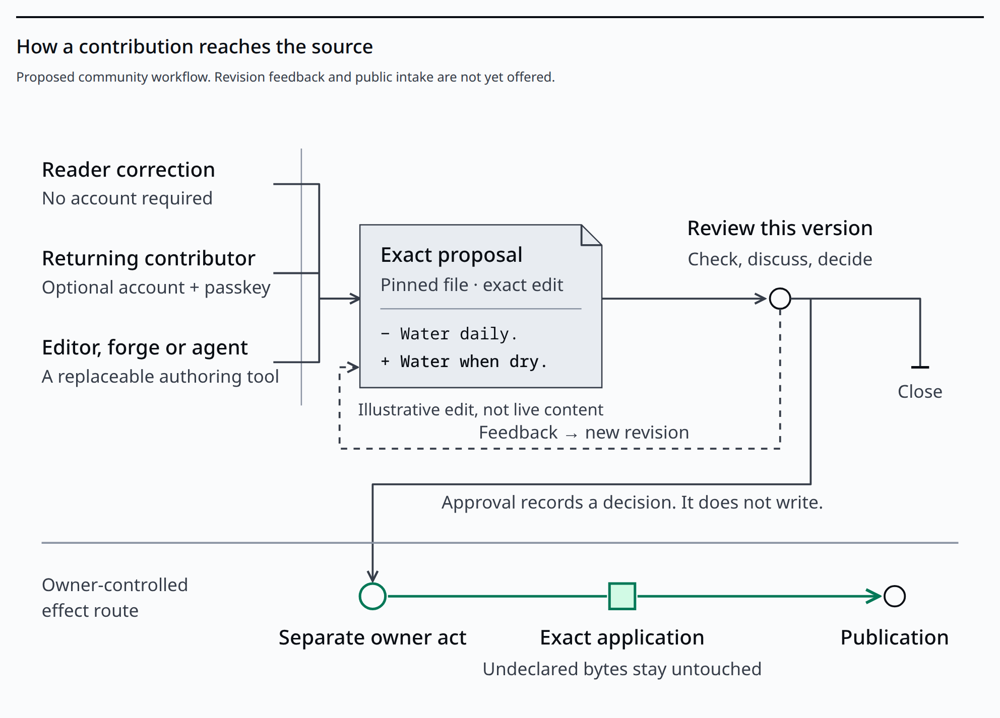
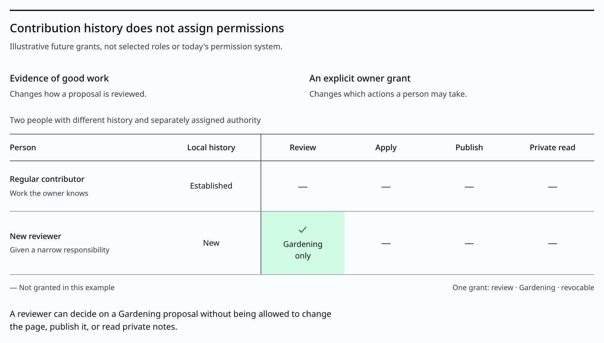

import CommunityDiagram from '../../../components/CommunityDiagram.astro';

## The model in one minute

**A reader can help without joining. A contributor can build a history. A trusted contributor can earn more freedom. A steward can receive a specific responsibility. The owner sets the rules and keeps control of the source.**

This is an owner-governed knowledge community, not just an owner publishing tool with a suggestion box. It is also not a requirement to build a discussion forum. Discourse inspires the progression from participation to trust; Cyberbaser's central object is a proposed improvement to knowledge, not a forum post.

<CommunityDiagram kind="journey" />

Five rules behind the journey

1. **Joining is optional; accountability is not.** Account-free suggestions can receive careful review without claiming a verified author.
2. **A login says who is acting, not what they may do.** Accounts and passkeys are separate from permissions.
3. **Trust earns less friction, not ownership.** Good contribution evidence may change review requirements. It cannot erase source-safety checks.
4. **Responsibility is granted deliberately.** Reviewing, applying, publishing and administering are different permissions, even when one person initially holds all of them.
5. **Sharing is a separate choice.** Permission to contribute does not reveal private notes; permission to read or edit does not permit publication.

**Status, 2026-11-13:** this is the canonical **working definition**, authorized for documentation by the maintainer. The community vision, account-free principle, owner-controlled source and exact-change safeguards are established direction. Basic embedded Better Auth with passkey support is the preferred account direction; shared SSO is not required. The proposed responsibilities, progression defaults and future workflows below are not an implemented permission system or an approved role schema. They must not be mistaken for live capabilities.

## People are not a ladder of permissions

A person can wear several hats. These names explain responsibilities; they are not database roles or automatic promotion levels.

| Person or responsibility | Their experience | What it does not imply |
|---|---|---|
| **Reader** | Reads the published knowledge and can suggest an improvement through an offered account-free route | No account, private-vault access or source-write authority |
| **Contributor** | Proposes improvements; may keep a local account or use a verified identity from a supported external path | No automatic trust or review/publish permission |
| **Trusted contributor** | Has evidence the local owner recognizes; may receive lower-friction contribution rules | Not automatically a moderator, reviewer or publisher |
| **Reviewer** | Has an explicit grant to assess proposals in a defined area | An editorial decision is not source application or publication |
| **Publisher** | Has an explicit grant to release reviewed content to a defined destination under policy | Cannot publish every private note or administer accounts merely by holding this grant |
| **Owner** | Controls the authoritative source, participation policy, delegations and publication boundaries | Cannot make unsafe or stale proposals valid by changing a trust label |

Application is another explicit permission: putting an approved exact change into the source. A deployment may deliberately combine application and publication in one authorized action, as the existing owner Save-and-publish does. They must still be distinguishable in policy and evidence.

**Recommended first configuration:** the owner holds review, application, publication and administration authority. Contributors hold proposal rights only. Later delegation must be selected and tested before those responsibilities move to anyone else.

## Four everyday journeys

### 1. “I spotted something wrong”

A signed-out reader finds an incorrect sentence, submits a correction and a reason, and receives a receipt. They do not have to create an account. Intake applies bounds and abuse controls, then the proposal receives full review. The reader never gains access to the private vault or the owner's session.

The target experience includes a safe way to check the outcome without exposing other submissions or private review notes. That status/reply mechanism is not selected or implemented by this model. Anonymous does not promise email follow-up, durable identity or verified public credit.

**Current evidence:** account-free derivation, a finite queue and a disabled/private-site form exist. Public exposure and unfamiliar-reader usability are not established; Q09 remains open.

### 2. “I want to keep helping”

A reader optionally creates an account and registers a passkey, or uses another offered verified contributor path. They can build a contribution history and, in the target experience, revisit proposals, respond to feedback and receive credit according to their preferences.

For substantial work, they use a suitable editor: raw Markdown, a rich browser interface, a forge or another tool. The interface returns a bounded proposal; it does not become a second authority over the original files. A request for changes leads to a new immutable proposal revision linked to the previous one, not an invisible rewrite of evidence already reviewed. This revision behavior is a proposed future contract, not a change to v1.

**Current evidence:** the borrowed GitHub path works. Embedded passkey accounts, general contributor profiles, discussion/revision workflow and a selected rich external editor are unbuilt here. The current proposal contract supports one existing file and one splice; a richer single-file multi-operation successor is researched, not selected.

### 3. “You know my work now”

The owner sees a pattern of useful, well-supported contributions and recognizes the contributor as trusted in a particular area. The proposed progression can reduce contribution friction, such as admission limits or the amount of editorial review, within an explicit policy. A familiar contributor proposing a sensitive structural change can still need full review.

Trust should be understandable: **what evidence supports it, where it applies, what it changes, and why it was reduced or withdrawn**. A login, elapsed time, a large edit count or a self-declared category is insufficient by itself. The first release can use deliberate owner designation. Evidence-backed progression comes later without pretending the manual list is the final product.

**Current evidence:** policy-based trust classification exists. Automatic earned-trust computation, promotion thresholds and a complete cross-path contribution history do not.

### 4. “Please help me look after this collection”

The owner explicitly delegates a responsibility. For example: “Review proposals for the Gardening collection, but do not apply changes or publish.” Another grant could allow publication of reviewed public Gardening pages to the public site. Neither grant opens the owner's private journal.

The recipient can see the scope of the responsibility, and the owner can revoke it. The system records the actual contributor, reviewer and acting publisher rather than crediting every action to a shared service identity. Losing a grant prevents new unauthorized effects; it does not erase historical decisions or retract already-public content. Queued-job revocation semantics must be designed before delegation is implemented.

**Current evidence:** the owner review/decision and separate Apply mechanisms exist. General delegated stewardship and publishing roles are future design, not enabled capabilities.

## The trust model

<CommunityDiagram kind="trust" />

### Familiarity and responsibility are different axes

Use the familiar progression **new → known → trusted** to explain local editorial confidence. Treat those as explanatory labels, not a locked three-level schema or a copy of Discourse's numbered levels.

Use separate grants for **review → apply → publish → administer**. These are distinct responsibilities, not a promotion ladder. A trusted subject expert might never want to review anyone else's work. An appointed reviewer might need a narrow responsibility before accumulating local contribution history. Neither case requires distorting a reputation score.

A future policy decision considers the verified or anonymous subject, recognized contribution evidence, affected content, actual change characteristics, integrity results and current owner policy. It produces an explainable review route or scoped permission decision, not a universal score.

### Proposed defaults

- Anonymous and unverified submissions receive full review; a claimed name remains a claim.
- Trusted status is local to the knowledge base and may be narrower than the whole base.
- No contribution may promote its own author or modify the policy used to judge itself.
- Rejection is not automatically misconduct. A good-faith disagreement or an out-of-scope proposal need not reduce trust.
- Abuse can justify restrictions or revocation, with reason and owner oversight. Edge abuse protection remains separate from editorial reputation.
- Automated promotion, demotion, acceptance or publication stays off until its evidence, appeal/reconsideration behavior and bounded policy are explicitly selected.
- Revoked or unknown identity cannot retain privileged permissions by falling back to “anonymous.” Where permitted, only a separately admitted anonymous proposal may proceed through full review.

These are recommended design defaults, not claims about existing enforcement. The classifier already computes full-review, quick-review and a potential auto-merge route. Historical records report the GitHub trust workflow inactive and auto-merge disabled. This documentation wave did not recheck live GitHub state. See the [workflow review model](/cyberbaser/design/contribution-workflows/#review-model).

## What permission looks like

Use a sentence a person can understand:

> **This person may do this action, on this content, under these conditions, until this grant ends.**

For publication, also name the destination. For source-changing actions, bind the exact reviewed version and revalidate current source and permission. The sentence is a design requirement, not a new wire schema.

Examples of **proposed future grants**:

- “Alex may review Gardening proposals until the end of the month. Alex may not apply or publish them.”
- “Sam may publish approved public Gardening changes to the public site. Private collections and policy changes are excluded.”
- “This agent may submit sourced corrections to existing pages. It may not approve its own work or acquire publishing credentials.”

Authentication identifies the actor. Trust influences scrutiny. Authorization permits a scoped action. Source checks establish that the exact effect is safe. All four are needed where applicable; none substitutes for the others.

### Read, contribute and release are separate

| Permission | Human meaning | Safe boundary |
|---|---|---|
| Read | “You may see this content.” | Public access or an explicit private-content grant |
| Propose | “You may suggest changes here.” | No canonical write; only supported bounded operations |
| Review | “You may record an editorial decision here.” | No implicit Apply or Publish |
| Apply | “You may put this approved exact change into the source.” | Fresh source and authority checks |
| Publish | “You may release this reviewed content there.” | Selected content and destination; no broader disclosure |
| Administer | “You may manage these accounts or policies.” | Account administration does not silently grant publication; policy-grant powers require their own scope |

The target must check access to the review evidence itself. A public proposal must not expose unrelated private source, private discussion, job diagnostics or credentials through its receipt. Private-host membership is not a blanket read or publish grant.

## The life of an improvement

Think in four phases rather than one overloaded status:

1. **Propose and revise:** preserve what was suggested, why, by whom or through which anonymous path, and against which source version.
2. **Review and decide:** show the exact candidate, checks and discussion; record the decision against that specific revision.
3. **Apply under authority:** independently recheck source and permission, then change only declared bytes. A changed proposal cannot inherit approval of an older revision.
4. **Publish and observe:** release only permitted content, record the destination and job, and distinguish intended publication from a verified live result.

A discussion message is not approval. Approval is not application. Application is not proof of publication. A deployment success is not proof that the expected content is visible. The owner may deliberately authorize a combined action, but its effects remain explicit.

Do not collapse every phase into one database enum. The existing queue retains `pending-review` or `expired`; separate records hold decisions, application events and job outcomes. Future revisions, discussion and contributor-facing status should compose those facts rather than changing the meaning of old receipts. See the [proposal operating model](/cyberbaser/research/proposal-operating-model/) and [owner application event](/cyberbaser/design/owner-application-event/).

## Sharing is separate from contribution

**Public publication:** the owner selects which pages and assets leave the source. The default-deny publication boundary is built. Website filtering does not conceal files or history in a public repository.

**Private collaboration:** people or groups may receive access to selected nonpublic content through an independently operated authoring/access system. Rich mixed-privacy RBAC and real-time collaboration remain assigned to the separate authoring-host scope, not claimed as general Cyberbaser v1 features. Cyberbaser must honor explicit integration permissions without making that particular host mandatory or inheriting its users' publishing authority.

**Sharing between bases:** independently owned bases may eventually exchange links, proposals and source-qualified contribution evidence. Each receiver decides what evidence it trusts. No mandatory SSO, central reputation score or shared identity database follows. Demonstrated independent-peer need still precedes federation protocol work.

Content licensing and credit are separate again: visibility does not grant reuse rights, and a display name does not establish verified authorship. Anonymous and pseudonymous credit need consent and an honest provenance policy, not forced real names. The measured GitHub attribution result covers only its tested path. See [legal and governance](/cyberbaser/design/legal-and-governance/) and [federated identity research](/cyberbaser/research/federated-identity/).

## Where Better Auth belongs

**Embedded Better Auth with passkey support, not shared SSO**, is the preferred account direction. Better Auth supports [WebAuthn passkeys](https://www.better-auth.com/docs/plugins/passkey), including device authenticators and external security keys. No Cyberbaser integration has been built or tested yet.

An account proves control of a stable local identity, not a legal identity or editorial reliability. Choose the secure origin and stable relying-party domain before enrollment; this matters to the deployment architecture, not just the login screen. Account admission, multiple authenticators, recovery, session expiry and revocation require an explicit contract. Recovery must not become an easier route to privileged access.

Keep credential and session custody in a small replaceable authentication component, outside proposal/trust packages and governance evidence. Existing architecture rules against identity-source-of-record and durable browser-credential authority need explicit reconciliation before that component is implemented. This definition does not silently amend them. See [authentication reuse](/cyberbaser/research/authentication-reuse/).

### Access tiers: abuse protection without a forced account

**Maintainer direction, 2026-11-16:** public suggestions need bot and abuse protection, but an account must not become the price of a one-off correction. Accounts are also not a bot defense on their own, because scripts can register too. Use accounts for continuity and higher limits instead.

| Tier | Sign-in | Protection and benefits |
|---|---|---|
| **Anonymous** | None | Edge rate limit, an account-free bot check such as Cloudflare Turnstile, per-sender and per-page limits, and a capped inbox. Full review. |
| **Contributor account** | Passkey, or a password if the owner enables it | Higher limits, contribution history, credit and follow-up on a suggestion. |
| **Trusted** | Same account | Recognized by the owner; may receive less review friction. Still no automatic Apply or Publish. |

The anonymous floor stays open. The inbox cap is the decisive protection: a successful flood can fill the review queue but cannot change the vault, because suggestions never write. The [proposal hub research](/cyberbaser/research/proposal-hub-bom/#rate-limiting-in-four-layers) records the layered design. Its earlier bot-fork and whole-file submission mechanics are superseded by the exact proposal queue; the layered limits still apply.

**Passwords are an owner setting, off by default.** Passkeys remain the preferred sign-in. When the owner enables passwords, Better Auth's [Have I Been Pwned plugin](https://www.better-auth.com/docs/plugins/have-i-been-pwned) refuses passwords found in known breaches at sign-up and password change. It sends only the first five characters of the password's SHA-1 hash, never the password. Prefer length over composition rules. Passwords usually imply email-based reset, which means storing email addresses and accepting reset as an attack path; that trade-off belongs to the owner who turns them on. Recovery must never become an easier route to owner authority.

**Do not build authentication.** Use a maintained library (the current preference is Better Auth) for credential storage, hashing, passkeys, breach checks and sessions. Cyberbaser decides who may do what; it should not implement cryptographic login itself.

None of these tiers, the bot check or contributor accounts exists yet. The first owner-only slice still enrolls just the owner; public contributor registration remains a later configuration.

## Long-term architecture, delivered in smaller configurations

The long-term destination determines responsibilities now; it does not require building every capability now. These are logical boundaries, not a requirement for six services:

- **Identity:** authenticates accounts and verifies optional external identity evidence.
- **Participation policy:** governs admission, local trust and review requirements.
- **Editorial workflow:** retains proposals, future revisions/discussion and exact decisions.
- **Action authority:** permits review, Apply, Publish and administrative actions within scope.
- **Governance evidence:** records actor, reason, policy and actual outcome without credentials.
- **Source and publication boundary:** preserves one authoritative source, exact changes and selected disclosure across replaceable tools.

### Near term: one owner, useful participation

Deliver a coherent owner workflow with passkey-capable authentication, explicit source/publication binding, a usable account-free contribution experience when offered, manual local trust designation and honest outcome records. Only the owner holds effectful grants. Preserve the current narrow proposal contract and close the public-exposure, abuse and human-use gaps before offering intake.

**Success means:** a reader can submit without joining, the owner can understand and decide, a separate authorized act can reach the intended page, and both can understand the outcome without unintended disclosure. This is a target, not today's acceptance claim.

### Next: a small knowledge community

Add optional contributor accounts and history, richer authoring, revision/request-changes workflows, visible credit and narrowly delegated review. Evaluate earned-trust progression against real contribution evidence, not invented thresholds. Select the richer proposal contract and editor only after evidence justifies them.

**Success means:** a returning contributor can improve a proposal after feedback, understand their standing, and work with a scoped reviewer without giving that reviewer publishing power.

### Longer term: shared stewardship and independent bases

Consider scoped delegated application/publication, multiple collections and destinations, integrated private collaboration and optional portable contribution evidence. The owner governs and can revoke delegation without personally clicking every action forever. This is a future policy decision; neither delegated publishing nor policy automation is enabled today.

**Success means:** responsibility can be shared without transferring blanket vault access or surrendering local authority. Cross-base protocol work starts only when real peers demonstrate the need.

### Choices to freeze now; choices to settle with evidence

**Define now:** separate identity/trust/access/action authority; exact revision-bound decisions; actual actor provenance; scoped and revocable grants; backward-compatible proposal evidence; an anonymous contribution floor; independent source/authoring/rendering components. A single owner today must not become a permanent single-person assumption.

**Settle before implementing the relevant slice:** account admission/recovery and credential custody; exact role/grant schema; trust promotion and reconsideration rules; reviewer self-approval/conflict policy; private evidence visibility; anonymous outcome/reply mechanism; queued-job revocation; richer operations and discussion retention. Use explicit decisions, not accidental defaults from an authentication library.

**Do not build by anticipation:** a universal policy engine, a forum clone, a global reputation service or a federation protocol. Reserving clean responsibilities is different from constructing speculative infrastructure.

## Evidence and related definitions

This page owns the intuitive community model. The [community system design](/cyberbaser/design/community-system-design/) translates it into proposed records, transitions, authority boundaries and acceptance gates, grounded in the existing contracts. Its first integrated proposal reconciles governance and identity/action evidence, defines job-phase revocation and stages the owner-to-community delivery sequence. New custody, permission and revision contracts remain proposed, not implementation approval. Other pages retain their narrower responsibilities:

- [Vision](/cyberbaser/getting-started/vision/) and [contribution on your terms](/cyberbaser/concepts/problem/#contribution-on-your-terms): original ambition and Discourse inspiration.
- [Contribution workflows](/cyberbaser/design/contribution-workflows/): implementation/offering inventory, not a second role model.
- [Proposal operating model](/cyberbaser/research/proposal-operating-model/): exact proposal and editorial-evidence mechanics.
- [Architecture](/cyberbaser/design/architecture/): component boundaries and implementation evidence.
- [Decision ledger](/cyberbaser/design/decision-ledger/): governance observations, not an established reputation dataset. Recorded live evidence remains one unclassified maintainer observation and zero classified observations; no live recheck was performed here.
- [Initial model recovery](/cyberbaser/agent-context/zz-log/2026-11-13-contribution-model-restored/), [long-term correction](/cyberbaser/agent-context/zz-log/2026-11-13-long-term-governance-direction/) and [intuitive definition](/cyberbaser/agent-context/zz-log/2026-11-13-community-model-definition/): chronology and authorization limits.
